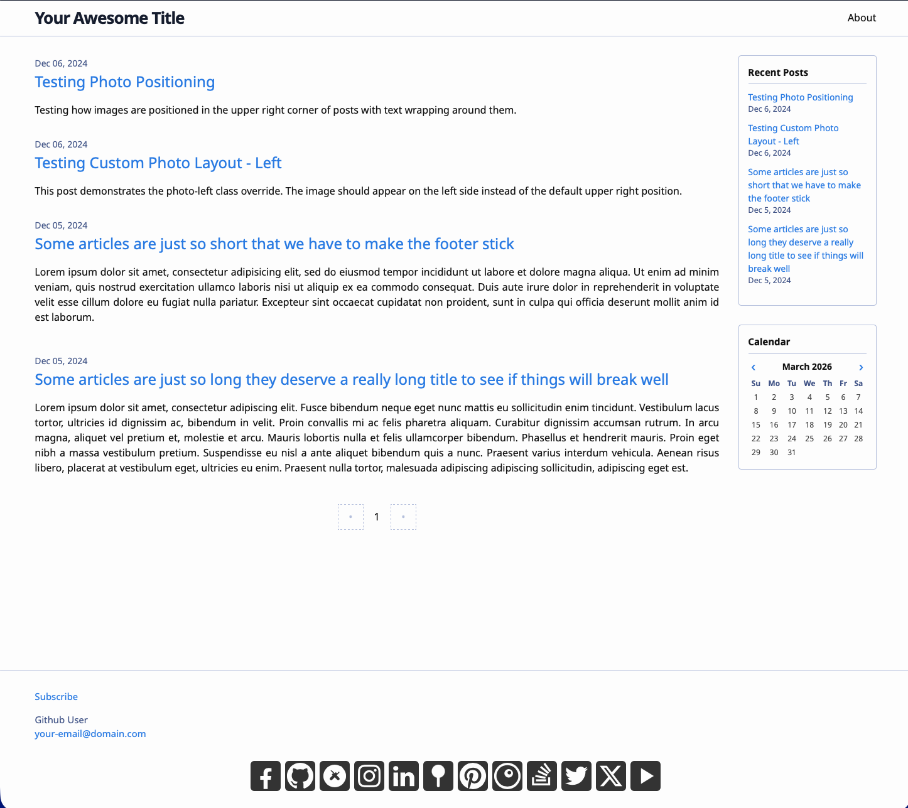
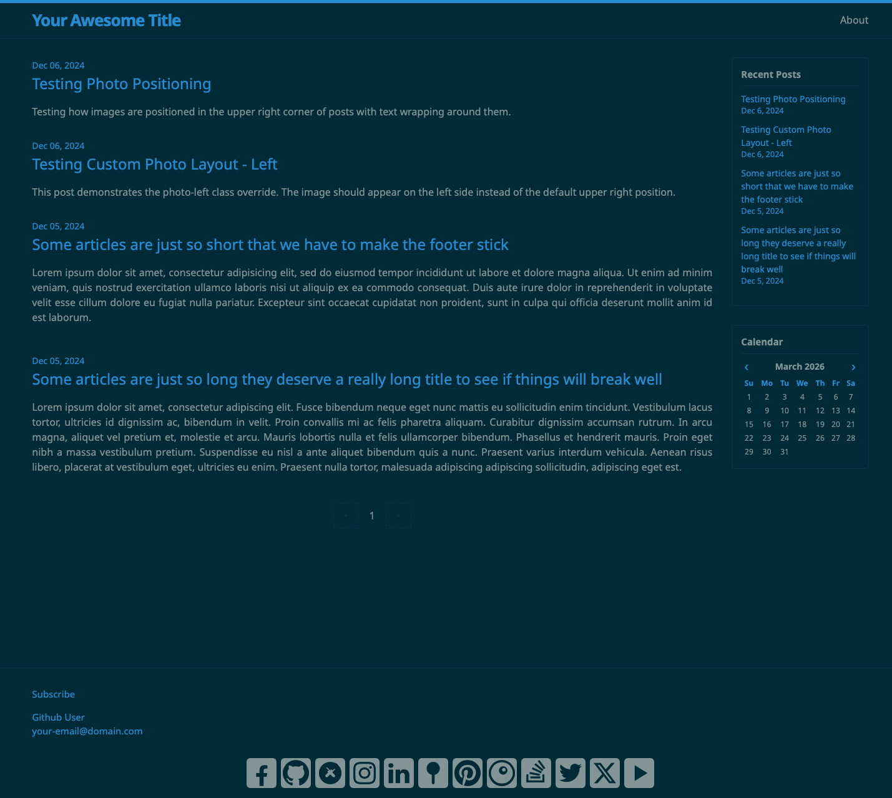
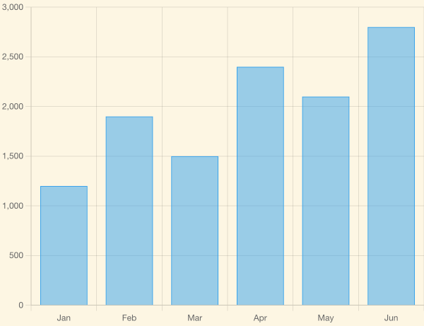
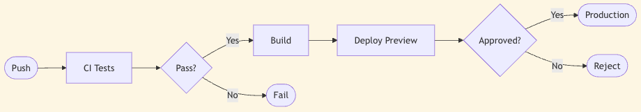

# Lord Stanley

[](https://github.com/jeffreyp/lord-stanley/actions/workflows/ci.yml)


A very much work-in-progress-but-one-day clean, responsive Jekyll theme. Inspired by the Minima theme but with enhanced features and improved structure.

Named after **[Frederick Stanley, 16th Earl of Derby](https://en.wikipedia.org/wiki/Frederick_Stanley,_16th_Earl_of_Derby)** (1841-1908), who served as Governor General of Canada and is best known for donating the Stanley Cup, the championship trophy of the National Hockey League.

## Screenshots

| Light | Dark |
|-------|------|
|  |  |

## Installation

Add this line to your Jekyll site's `Gemfile`:

```ruby
gem "jekyll-remote-theme"
```

And add these lines to your Jekyll site's `_config.yml`:

```yaml
plugins:
  - jekyll-remote-theme

remote_theme: jeffreyp/lord-stanley
```

Then execute:

```bash
bundle install
```

## Usage

### Basic Configuration

Update your `_config.yml` file with your site information:

```yaml
title: Your Site Title
author:
  name: Your Name
  email: your-email@domain.com

description: >
  Your site description for SEO and feed.xml

# SEO and site settings
url: "https://your-site.com"
baseurl: ""
lang: "en-US"
timezone: "America/New_York"

# Required plugins
plugins:
  - jekyll-feed
  - jekyll-seo-tag
  - jekyll-sitemap
  - jekyll-paginate-v2
  - jekyll-archives

# Google Analytics (optional)
google_analytics: GA_MEASUREMENT_ID  # Replace with your Google Analytics 4 measurement ID

# Theme-specific settings
lord-stanley:
  skin: classic  # Options: classic, dark, auto, solarized-light, solarized-dark, solarized
  date_format: "%b %d, %Y"
  sidebar_recent_posts: 10  # Number of posts in the sidebar Recent Posts widget

  # Social links in footer
  social_links:
    - { platform: github, user_url: "https://github.com/yourusername" }
    - { platform: twitter, user_url: "https://twitter.com/yourusername" }
    - { platform: linkedin, user_url: "https://linkedin.com/in/yourusername" }

# Navigation pages
header_pages:
  - about.md
  - contact.md

# Show post excerpts on homepage
show_excerpts: true

# Pagination (requires jekyll-paginate-v2)
pagination:
  enabled: true
  per_page: 5
  permalink: "/page:num/"

# Date, category, and tag archives (requires jekyll-archives)
jekyll-archives:
  enabled:
    - year
    - month
    - day
    - categories
    - tags
  layouts:
    year: archive
    month: archive
    day: archive
    category: archive
    tag: archive
  permalinks:
    year: "/:year/"
    month: "/:year/:month/"
    day: "/:year/:month/:day/"
    category: "/category/:name/"
    tag: "/tag/:name/"
```

### Color Schemes

The theme includes several built-in color schemes:

- `classic` - Default light theme
- `dark` - Dark variant of the classic theme
- `auto` - Automatically switches between light and dark based on system preference
- `solarized-light` - Light solarized theme
- `solarized-dark` - Dark solarized theme
- `solarized` - Auto-switching solarized theme

### Social Media Links

Add social media links to your footer by configuring the `social_links` array in `_config.yml`. Supported platforms include:

- facebook
- github
- google_scholar
- instagram
- linkedin
- pinboard
- pinterest
- rss
- smugmug
- stackoverflow
- twitter
- x
- youtube

### Navigation

Configure which pages appear in your header navigation using the `header_pages` setting. Pages will appear in the order listed.

### Customizing Sass Variables

Override theme defaults in `_sass/lord-stanley/custom-variables.scss` by configuring the forwarded module:

```scss
@forward "defaults" with (
  $spacing-unit: 24px,
  $content-width: 1200px
);
```

### Favicons

Add your icon files to your site, then list them in `_config.yml`. Every format is optional, so set only the ones you have:

```yaml
lord-stanley:
  favicon:
    ico: /favicon.ico                  # Older browsers; ideally 32x32
    svg: /favicon.svg                  # Modern browsers; scales to any size
    png: /favicon-96x96.png            # For browsers that prefer a PNG
    apple_touch: /apple-touch-icon.png # iOS home screen; 180x180
```

Paths respect `baseurl`, and full URLs also work. The theme doesn't include an icon of its own. If you don't set any, it adds no icon tags and browsers look for `/favicon.ico` in your site root.

### Fonts

Noto Sans is self-hosted from `assets/fonts/` (Latin and Latin Extended, licensed under the [SIL Open Font License](assets/fonts/OFL.txt)). Other scripts, such as Greek, Cyrillic and Devanagari, use the visitor's system fonts.

### Google Analytics

To enable Google Analytics tracking, add your measurement ID to `_config.yml`:

```yaml
google_analytics: G-XXXXXXXXXX  # Replace with your GA4 measurement ID
```

The theme includes:
- Privacy-respecting implementation that honors Do Not Track settings
- Automatic loading only in production environment
- Modern Google Analytics 4 support

### Content Security Policy

Set this in `_config.yml` to send a `Content-Security-Policy` through a `<meta>` tag:

```yaml
lord-stanley:
  content_security_policy: true
```

The policy allows scripts only from your site and the exact Chart.js and Mermaid versions the theme uses, plus Google Analytics when configured. It blocks inline scripts and iframes, so turn it off or edit `_includes/content-security-policy.html` if your posts embed videos, widgets or their own scripts. A `<meta>` policy can't set `frame-ancestors`, so use a response header from your host if you need clickjacking protection.

### Charts and Diagrams

Posts can opt into Chart.js (data charts) and Mermaid (diagrams) by setting front matter flags. The libraries are loaded only on pages that need them: the post itself, plus any home or archive page showing an excerpt that contains a chart or diagram (when `show_excerpts` is enabled). That way a chart or diagram above the post's excerpt separator renders in the post list too.

| Chart.js | Mermaid |
|----------|---------|
|  |  |

#### Chart.js

Add `charts: true` to your post's front matter, then pair a `<canvas>` with a JSON configuration block whose `data-chart` attribute names the canvas:

```markdown
---
layout: post
title: "My Data Post"
charts: true
---

<canvas id="my-chart" style="max-width: 600px;"></canvas>
<script type="application/json" data-chart="my-chart">
{
  "type": "bar",
  "data": {
    "labels": ["A", "B", "C"],
    "datasets": [{ "label": "Example", "data": [1, 2, 3] }]
  }
}
</script>
```

JSON can't hold functions. If you need callbacks, call `new Chart(...)` from an inline `<script>` instead, which requires turning off the Content Security Policy.

Supported chart types: `bar`, `line`, `pie`, `doughnut`, `radar`, `scatter`, `bubble`, and more. See the [Chart.js docs](https://www.chartjs.org/docs/latest/) for full options.

#### Mermaid Diagrams

Add `mermaid: true` to your post's front matter, then wrap diagram syntax in a `<div class="mermaid">` block:

```markdown
---
layout: post
title: "My Architecture Post"
mermaid: true
---

<div class="mermaid">
flowchart LR
  A[User] --> B[Server]
  B --> C[Database]
</div>
```

Supported diagram types include flowcharts, sequence diagrams, Gantt charts, class diagrams, pie charts, and more. See the [Mermaid docs](https://mermaid.js.org/intro/) for syntax.

Both flags can be combined in the same post:

```yaml
---
charts: true
mermaid: true
---
```

### Tags and Categories

Add `categories` and/or `tags` to a post's front matter as usual:

```yaml
---
layout: post
title: "My Post"
categories: misc
tags: [jekyll, tutorial]
---
```

Each post displays its categories and tags as badges below the byline, linking to an archive page listing every post with that category or tag (generated by `jekyll-archives` at `/category/:name/` and `/tag/:name/`). Two index pages, `/categories/` and `/tags/`, list every category and tag site-wide with post counts. Link to them from `header_pages` if you want them in the site navigation.

This feature requires `categories` and `tags` to be enabled in the `jekyll-archives` config shown above.

### Post Navigation

Post pages automatically show "Older" / "Newer" links to the adjacent posts (by publish date) at the bottom of the article. No configuration is needed; this uses Jekyll's built-in `page.previous`/`page.next`.

### Posts and Pages

Create posts in the `_posts` directory using the standard Jekyll naming convention:

```
_posts/YYYY-MM-DD-title.md
```

Create pages as Markdown files in your root directory or in subdirectories.

## Customization

### Overriding Theme Files

You can override any theme file by creating a file with the same name in your site's directory structure:

- `_layouts/` - Page layouts
- `_includes/` - Reusable components
- `_sass/` - Stylesheet partials
- `assets/` - CSS and other assets

### Custom Styles

Add custom CSS by creating `assets/styles.scss` in your site and importing the theme:

```scss
---
---

@import "lord-stanley";

// Your custom styles here
.custom-class {
  color: #your-color;
}
```


## Development

To set up the development environment:

1. Clone the repository
2. Run `bundle install`
3. Run `bundle exec jekyll serve`
4. Open http://localhost:4000 in your browser

### File Structure

```
lord-stanley/
├── _includes/                    # Reusable components
│   ├── head.html                # HTML head section
│   ├── header.html              # Site header
│   ├── footer.html              # Site footer
│   ├── sidebar.html             # Sidebar (includes widgets below)
│   ├── sidebar-recent-posts.html # Recent posts widget
│   ├── sidebar-calendar.html    # Interactive calendar widget
│   └── social-icons/            # Social media icons
├── _layouts/                    # Page layouts
│   ├── base.html               # Base HTML structure
│   ├── home.html               # Homepage layout with pagination
│   ├── page.html               # Static page layout
│   ├── post.html               # Blog post layout
│   └── archive.html            # Date/category/tag archive layout
├── _sass/                       # Stylesheet partials
│   └── lord-stanley/            # Theme styles
├── assets/                      # Compiled assets
├── tags.html                    # Site-wide tag index (/tags/)
├── categories.html              # Site-wide category index (/categories/)
└── _config.yml                  # Theme configuration
```

## Contributing

Bug reports and pull requests are welcome on GitHub at https://github.com/jeffreyp/lord-stanley.

Every push and pull request runs the site through `jekyll build` and [html-proofer](https://github.com/gjtorikian/html-proofer) (broken internal links, images, and scripts) via GitHub Actions. Run the same checks locally with:

```sh
bundle exec jekyll build
bundle exec htmlproofer ./_site --disable-external --allow-hash-href
```

## License

The theme is available as open source under the terms of the [MIT License](https://opensource.org/licenses/MIT).

## Credits

Originally inspired by the [Minima Jekyll theme](https://github.com/jekyll/minima). Built with modern Jekyll best practices and enhanced for better SEO and user experience.
